# Elite Coating Sdn Bhd – Company Website

The company website for **Elite Coating Sdn Bhd**, an industrial powder coating and wet painting company in Sungai Petani, Kedah. It is a fast static site in **English, 中文 and Bahasa Melayu**, generated by a Python build script.

**Preview:** [dwong3393-creator.github.io/elite-coating-website](https://dwong3393-creator.github.io/elite-coating-website/)  
*The site is not on the company's own domain yet. The preview is hidden from search engines.*

Designed and built by **Dickson Wong**.

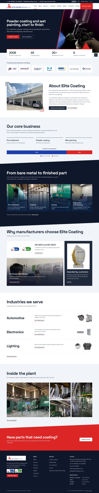

## Highlights

- **Three languages from one source.** `build-site.py` writes every page in English, then `translations.py` produces the Chinese and Malay versions. The build stops if any text is missing a translation.
- **10 pages per language:** home, about, services, products, facilities, quality, customers, contact, privacy and a 404 page.
- **Built for speed:** no framework, minified CSS and JS, WebP images, self-hosted fonts.
- **Small touches:** light and dark theme, an "open now / closed" status from the opening hours, a photo lightbox, and product groups by industry.
- **Quality checks:** `check-site.py` looks for broken links, missing images, duplicate ids and missing alt text.
- **Hosting pack:** `make-upload.py` checks the site, then zips it with an `.htaccess` file (compression, caching, 404 page, https redirect) and instructions for the hosting company.

## Tech stack

Python (Pillow, rcssmin, rjsmin) · HTML · CSS · JavaScript · GitHub Actions / Pages

## Screenshots

| About | Services |
|---|---|
| 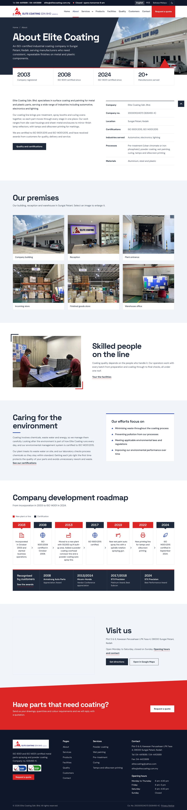 | 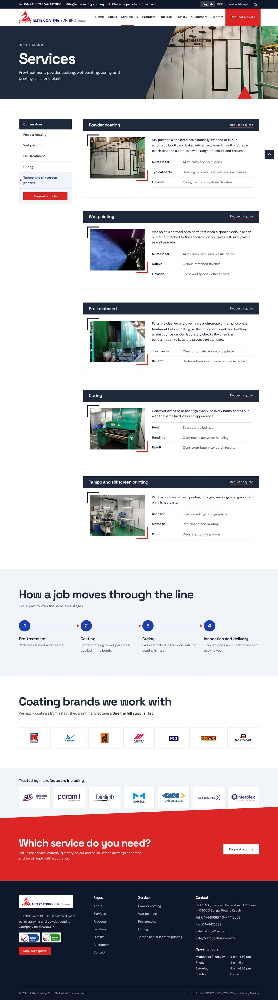 |

| Products | Facilities |
|---|---|
| 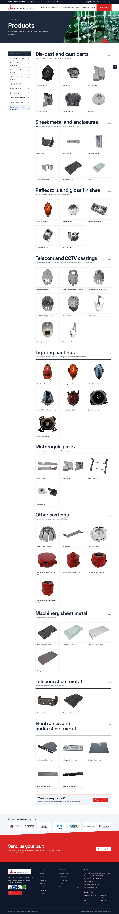 | 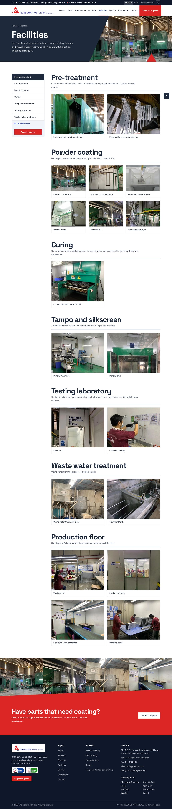 |

| Quality | Customers |
|---|---|
| 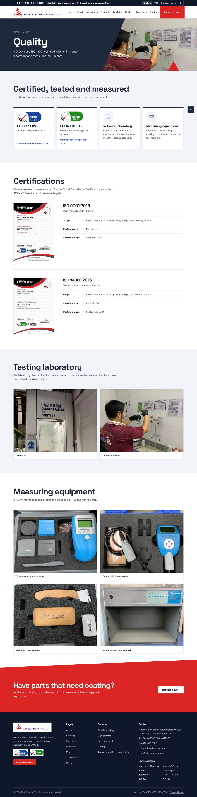 | 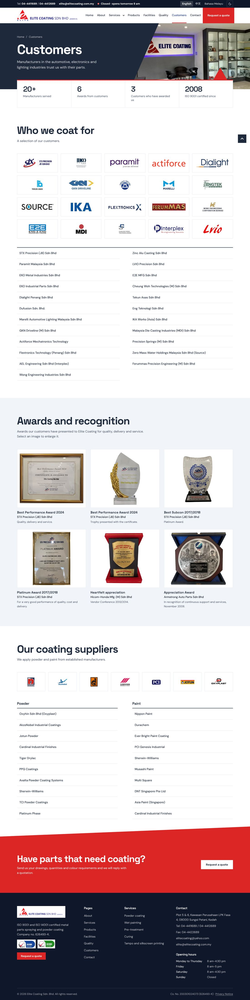 |

| Contact | |
|---|---|
| 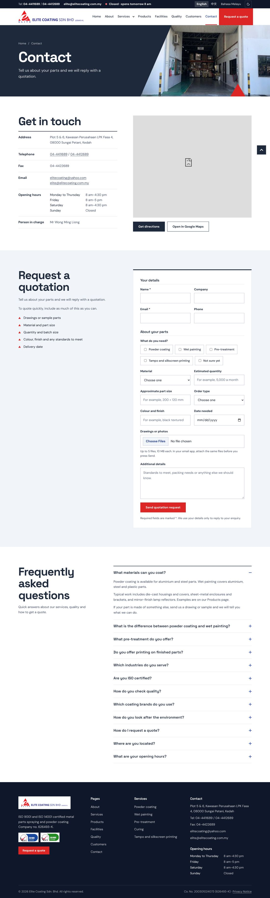 | |

### Chinese and Malay versions

| 中文 | Bahasa Melayu |
|---|---|
| 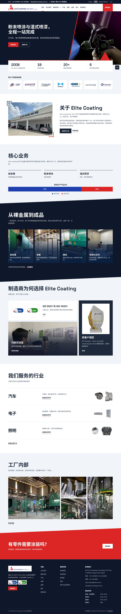 | 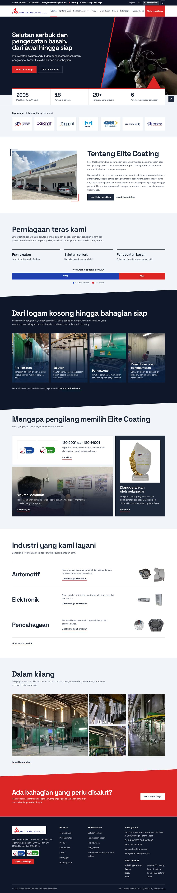 |

### On a phone

| Home | Products | Contact |
|---|---|---|
| 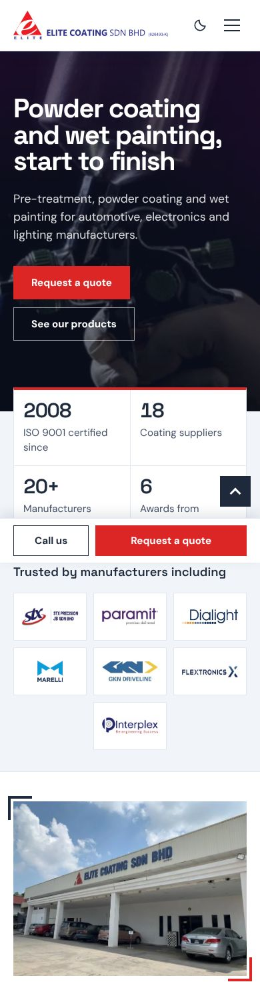 | 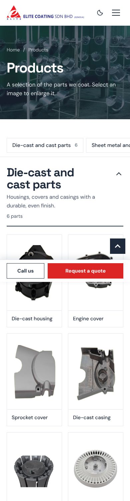 | 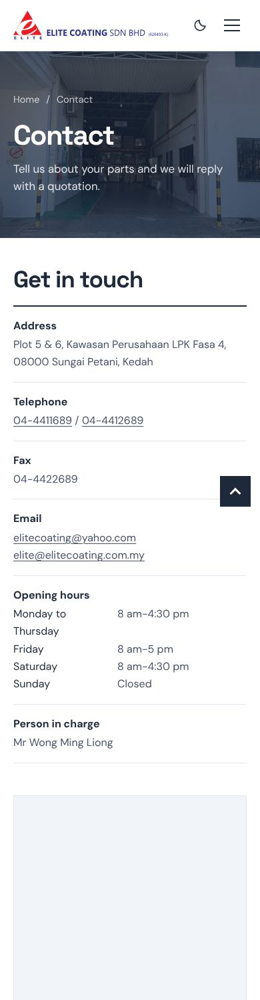 |

---

# Working on the site

A static website in English, Chinese and Malay. A Python script writes the pages; there is no server code.

## Set up once

Install Python 3, then run:

    pip install -r requirements.txt

## Build and check

    python build-site.py     # writes the pages into site/ (English), site/zh/ and site/ms/
    python check-site.py     # looks for broken links, missing images, duplicate ids, missing alt text

To look at the site, open `site/index.html`, or serve the `site/` folder.

`build-site.py` prints `UNTRANSLATED` and ends with an error if any English text has no Chinese or Malay version.
Add `--list` to see which texts.

## Where things live

| Path | What it is |
|---|---|
| `build-site.py` | The page templates, the page text in English, the phone numbers and opening hours |
| `translations.py` | Every English text with its Chinese and Malay version |
| `i18n.py` | Swaps English text for the translations (you rarely touch it) |
| `src/css/style.css` | All styling. Colours are at the top; the dark theme colours are at the bottom |
| `src/js/main.js` | Menu, theme switch, open-now status, lightbox, product groups |
| `site/` | The finished website. Do not edit pages here; the build overwrites them |
| `site/assets/` | Photos, logos and fonts. Add images here by hand; the build does not touch them |
| `make-share-images.py` | Draws the 1200x630 pictures shown when a link is shared (needs the Windows fonts) |
| `share-preview.html` | A mock-up of how those shared links look |
| `check-site.py` | Checks the built site for broken links, missing images and similar problems |
| `make-upload.py` | Makes `upload/Elite-Coating-Website-Hosting-Pack.zip` |
| `upload/` | Holds only the hosting zip (the site, a server settings file and instructions for the hoster). Made by `make-upload.py`; do not edit |
| `backups/` | Dated copies of the whole project |

The build writes `site/css/style.min.css` and `site/js/main.min.js` from the files in `src/`. Edit the `src/` files, never the `.min` files.

## Put the site online

1. Set `SITE_URL` in `build-site.py` to the real address (see "Fill in the website address" below).
2. Run `python build-site.py`, then `python make-upload.py`. The second command checks the site first and stops if it finds a problem, then makes the zip.
3. Send `upload/Elite-Coating-Website-Hosting-Pack.zip` to the hosting person: it holds the site and a plain-text instruction sheet for them. To upload it yourself, unzip it and put everything inside its `website/` folder into the host's web folder, usually `public_html`. This includes the hidden `.htaccess` file; turn on "show hidden files" in the upload tool if it is missing.
4. Open the address and click through a few pages in each language.
5. Once the host has installed an SSL certificate (the padlock, https), open `.htaccess`, remove the `#` from the five lines marked for the https redirect, and upload it again.

`.htaccess` works on Apache and LiteSpeed hosts (most shared hosting and cPanel). On another kind of server it is ignored; ask the host to turn on compression, to serve `404.html` for missing pages, and to redirect http to https.

If the site goes in a sub-folder instead of the web root, change `/404.html` in `.htaccess` to `/folder-name/404.html`.

## Common changes

**Phone number or opening hours.** Edit `PHONES` or `HOURS_MON_THU_SAT` / `HOURS_FRI` near the top of `build-site.py`, then rebuild. The contact page, top bar, call button, FAQ answer, Google data and the open-now status all follow.

**Change wording.** Edit the English text in `build-site.py`, then edit its Chinese and Malay lines in `translations.py` (they match on the exact English text, so change both). Rebuild.

**Add a product photo.** Save a transparent WebP into `site/assets/img/products/pdf/`, then add a line to a group in `PRODUCT_GROUPS` in `build-site.py`: `("pdf/name", "description", "caption")`. Add the caption and description to `translations.py`. Rebuild.

**Fill in the website address.** Set `SITE_URL = "https://www.your-domain"` in `build-site.py` and rebuild. This adds `sitemap.xml`, canonical and language links, and the picture and address in the share tags. Without it only `robots.txt` and the basic share tags are written.

**Change the share picture.** Edit the text or photo in `make-share-images.py` and run `python make-share-images.py`.

## Before big changes

Copy `build-site.py`, `i18n.py`, `translations.py`, `make-share-images.py`, `src/` and `site/` into a new folder under `backups/`.
